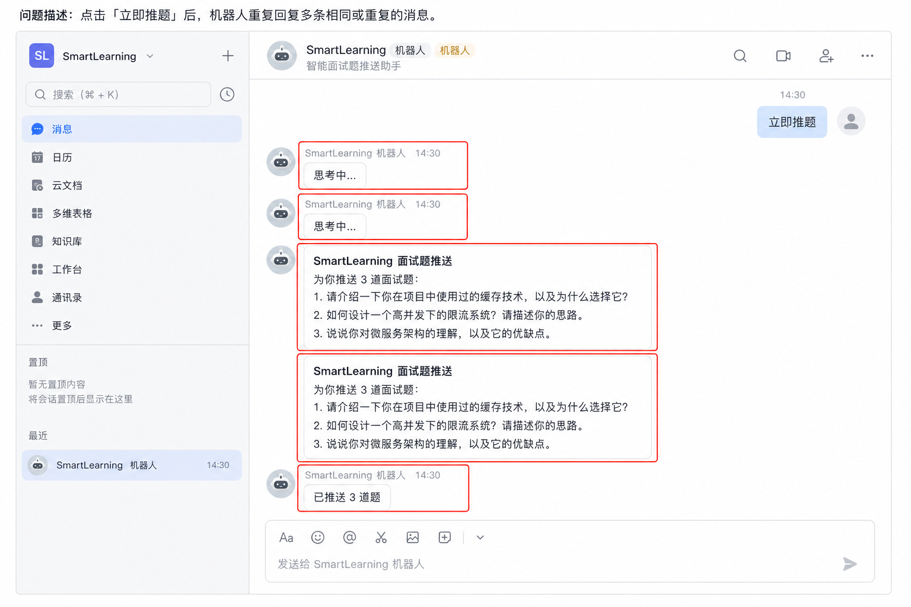
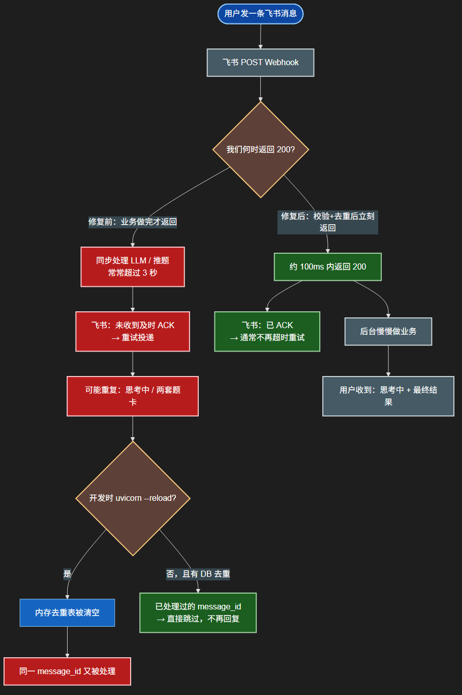
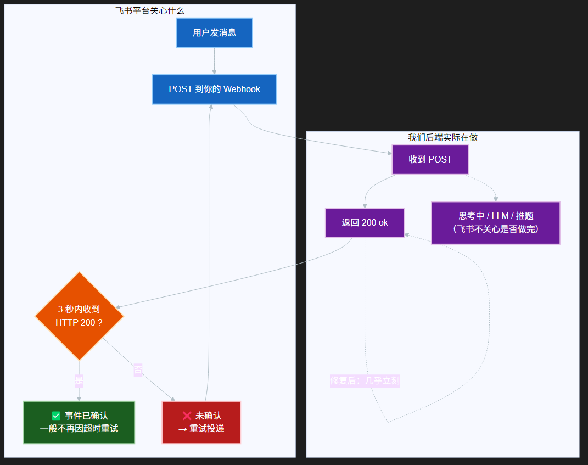
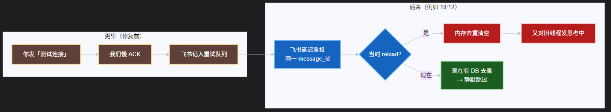
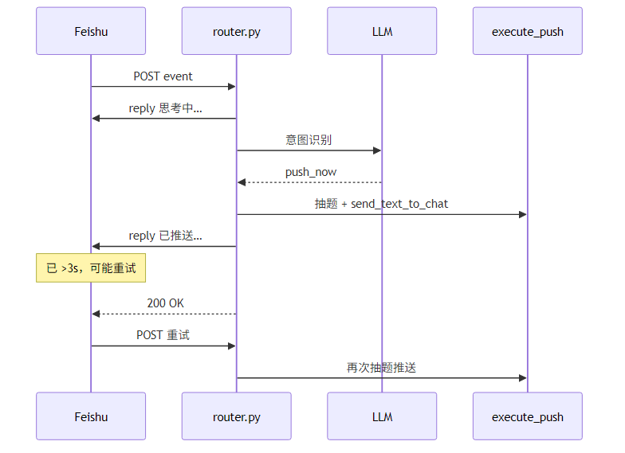
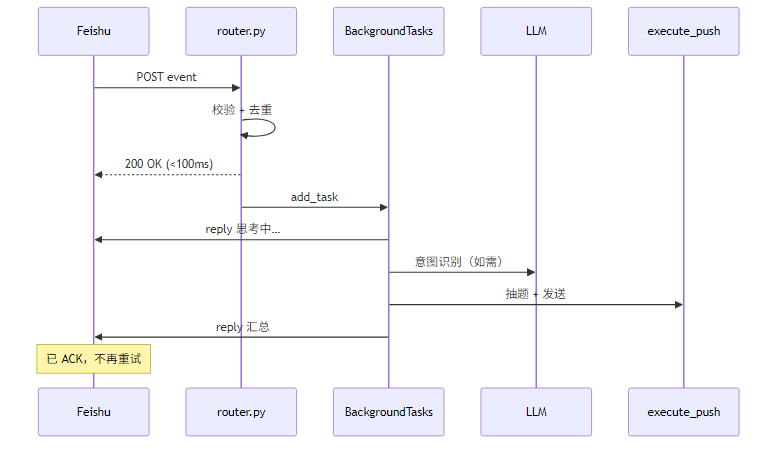

# 飞书 Webhook 超时与重复回复问题

本文档汇总 SmartLearning 飞书 Bot 在联调中出现的 **重复回复、超时重试、旧消息一小时后仍触发** 等问题：现象、责任归属、根因、已实现修复、日志判读与运维建议。

---

## 问题总结（TL;DR）

### 发生了什么

用户在飞书私聊发送 **「立即推题」**、**「测试连接」** 等指令后，出现：

- 同一线程内 **多次「思考中…」**、**两套不同题目**（真 Bug）；
- 或一次操作收到 **2～3 条** 机器人消息（部分为设计行为，见 §2.4）；
- 或 **数分钟 / 一小时后**，对 **很早以前的旧消息** 突然又回复「思考中…」。

### 责任归属：主要是我们，飞书重试是正常机制

| 维度 | 谁的问题 | 说明 |
|------|----------|------|
| Webhook **超过约 3 秒才返回 200** | **我们（修复前）** | 在单次 HTTP 请求里同步做完 LLM、推题、发消息，最后才 ACK |
| 飞书 **反复 POST 同一用户消息** | **飞书按约定重试** | 未 timely ACK 时会重投；可能间隔数分钟到数小时（退避） |
| `uvicorn --reload` 后 **再次处理同一消息** | **我们（已缓解）** | 内存去重被清空；现用 DB 表 `feishu_processed_messages` 按 `message_id` 持久去重 |
| 帮助写「立即推题」但代码只认「立即推送」 | **我们（已修复）** | 多走一轮 LLM，放大超时概率 |
| 「测试连接」走 RAG，加载模型 20s+ | **我们（已修复）** | 快捷 `reply_only`，不再加载 embedding |

**飞书眼里的「处理完」= Webhook 在约 3 秒内返回 `200` + `{"ok":true}`**，与 LLM 是否跑完、用户是否已看到最终回复 **无关**。

### 已实现的修复（当前代码）

1. **先 ACK，后处理**：校验 / 去重后立即 `200`，业务在 `BackgroundTasks` 中执行（`router.py`）。
2. **双重去重**：内存 `event_id` + `message_id`；数据库 **`feishu_processed_messages`**（迁移 `0012`）跨 reload 生效。
3. **快捷路由**：「立即推题」→ `push_now`；「测试连接」→ `reply_only`（`agent.py`）。
4. **可观测日志**：`feishu webhook ack queued-background Xms` / `feishu skip already processed` / `feishu processing`（在 ack **之后**）。

### 如何确认「不是又回到修复前」

看 `uvicorn` 日志 **时间顺序**：

```text
✅ 修复后（正常）
  POST /api/integrations/feishu/events 200 OK
  feishu webhook ack queued-background 2.3ms message_id=... event_id=...
  feishu processing message_id=... text='...'
  POST open.feishu.cn/.../reply

❌ 修复前（不应再出现）
  feishu processing / POST .../reply / LLM ...
  POST /api/integrations/feishu/events 200 OK   ← 200 在最后
```

文档流程图里的 **红色「修复前」分支** 仅用于说明旧架构，**不是** 运行时开关。一小时后仍对 **旧线程** 回复，通常是 **飞书迟到的重投** + **该 `message_id` 在去重表上线前已处理、未入库**。

### 仍可能看到的「非 Bug」现象

| 现象 | 原因 |
|------|------|
| 一次「立即推题」收到 思考中 + 题卡 +「已推送 N 道题」 | `push_now` 设计：`send_text_to_chat` 发题卡，`reply_text` 发汇总 |
| 一小时后对旧「测试连接」又回一句 | 飞书重试队列 + 旧 `message_id` 未写入去重表；补库或新发消息测试 |

### 手动屏蔽旧消息（可选）

对已不需要再回复的历史 `message_id`，插入去重表后，重投将只打日志、不再发「思考中…」：

```bash
cd backend
.\.venv\Scripts\python.exe -c "
from app.db.session import SessionLocal
from app.models.feishu_processed_message import FeishuProcessedMessage
db = SessionLocal()
db.merge(FeishuProcessedMessage(
    message_id='om_你的旧消息id',
    event_id=None,
    text_preview='测试连接',
))
db.commit()
db.close()
"
```

---

## 1. 现象

用户在飞书私聊机器人发送 **「立即推题」**（或点击快捷短语）后，同一线程内出现：

| 顺序 | 内容 | 说明 |
|------|------|------|
| 1 | `思考中…` | 机器人 thread 回复 |
| 2 | `SmartLearning 面试题推送` + 题目列表 | 独立消息（非 thread） |
| 3 | `已推送 N 道题到 M 个飞书用户` | thread 回复 |
| （异常） | 再次出现 1～2 的内容，且题目不同 | **重复执行** |

严重时一次操作会看到 **两次「思考中…」、两张题卡**，属于 Bug；前 3 条在设计上可能同时存在（见 §2.4），但不应出现两套不同题目。



*图 1：用户发送「立即推题」后，同一线程内出现多次「思考中…」与两套不同题目（Bug 现象）。*

---

## 2. 根因分析

### 2.1 飞书事件订阅的超时重试（主因）

飞书 [事件订阅](https://open.feishu.cn/document/server-docs/event-subscription-guide/overview) 要求服务端在 **约 3 秒内** 对 HTTP POST 返回 **200** 及合法 JSON（如 `{"ok": true}`）。若超时或未正确响应，平台会 **重试投递**（可能新 `event_id`、同一 `message_id`），导致业务逻辑执行多遍。

**修复前的实现**（`backend/app/integrations/feishu/router.py`）在 **同一次 HTTP 请求内** 顺序完成：

1. 调用 Gemini 做意图识别（「立即推题」曾未走快捷路由，额外 1～3 秒）
2. 抽题、调用飞书 API 推送题目
3. 发送 thread 回复
4. **最后** 才 `return JSONResponse({"ok": True})`

整条链路常超过 3 秒 → 飞书重试 → **同一用户操作执行两次** → 两次随机抽题，题目不同。

### 2.2 进程内去重在 reload 后失效（加重因素）

曾仅用内存字典 `_seen_events` / `_seen_messages` 去重。开发时：

```bash
uvicorn app.main:app --reload --port 8000
```

`watchfiles` 重启进程后内存表清空，飞书重试事件可能再次进入处理。

实际日志示例（修复前）：

```text
09:12:03  feishu agent tool=push_now
09:12:04  POST open.feishu.cn/.../messages
09:12:06  POST .../reply
09:12:06  POST /api/integrations/feishu/events 200   # 200 晚于业务
09:12:06  WatchFiles detected changes ... Reloading
```

### 2.3 快捷路由缺失（放大延迟）

| 用户说法 | 修复前 | 修复后 |
|----------|--------|--------|
| 立即推题 | 走 LLM → `push_now` | `_try_direct_route` → `push_now` |
| 测试连接 | 走 LLM + RAG（加载 embedding 20s+） | `reply_only` 连通提示 |

### 2.4 单次操作多条消息（易误解为「重复」，非 Bug）

`push_now` → `execute_push()`：

- 题目正文：`send_text_to_chat()`（独立消息，`📅 SmartLearning 面试题推送`）
- 汇总：`reply_text()`（thread 回复）
- 外加 router 的「思考中…」

一次成功操作至少 **2～3 条** 消息，与 §2.1 的 **真重复**（两套题卡）需区分。

### 2.5 延迟重投 + 去重表未覆盖的历史消息

飞书对 **修复前未 ACK** 的事件可能 **长时间重试**（数分钟～数小时）。若该 `message_id` 在 **`feishu_processed_messages` 上线前** 已处理过且未入库，后续重投仍会进入后台，表现为对 **旧消息线程** 再次发送「思考中…」。这不是代码回退到「业务做完才返回」，而是 **迟到重投 + 缺历史记录**。

---

## 图解：飞书 ACK 与重试（高对比度）

> 深底 + 白字 PNG，Cursor / GitHub 均可读。  
> 重新导出：`npx @mermaid-js/mermaid-cli -i ack-overview.mmd -o ack-overview.png -b "#1e1e1e" -w 1400`

### 总览：修复前 vs 修复后



| 颜色 | 含义 |
|------|------|
| 红 | 问题路径（慢 ACK、重试、重复回复） |
| 绿 | 正确路径（快 ACK、已确认、DB 跳过旧消息） |
| 蓝 / 灰 | 正常步骤 |

### 飞书眼里的「处理完」是什么？



### 为什么旧消息会「突然」又回复？



### FAQ：过了一小时还在回复，是不是又走了「修复前」？

**通常不是。** 对照日志：

| 日志 | 含义 |
|------|------|
| `feishu webhook ack queued-background 2.3ms ...` | ✅ 几毫秒内已 200，业务在后台 |
| `feishu processing ...` 在 ack **之后** | ✅ 正常（含飞书迟投的旧消息） |
| `feishu skip already processed message_id=...` | ✅ DB 挡住重投 |
| `POST .../feishu/events 200` 在所有 `reply` **之后** 数秒 | ❌ 修复前同步模式（当前不应出现） |

---

## 3. 修复方案（已实现）

### 3.1 先 ACK，后处理（核心）

Webhook 只做 **校验 + 去重 + 入队**，立即返回 `{"ok": true}`。  
业务在 `BackgroundTasks` → `_process_feishu_message()`，独立 `SessionLocal()`。

### 3.2 双重去重（内存 + 数据库）

| 层级 | 键 | 作用 |
|------|-----|------|
| 内存 LRU | `event_id` | 同进程内拦截同一事件重试 |
| 内存 LRU | `message_id` | 同进程内拦截同一用户消息 |
| SQLite `feishu_processed_messages` | `message_id` PK | **跨 reload** 拒绝已处理消息 |

实现：`backend/app/integrations/feishu/dedup.py`（`try_claim_message`），迁移 `0012`。

### 3.3 快捷路由

- 「测试连接」→ `reply_only`（不走 LLM/RAG）
- 「立即推题」→ `push_now`（不走 LLM 意图识别）

### 3.4 日志

- `feishu webhook ack queued-background Xms` — 已快速 ACK
- `feishu webhook ack skipped-duplicate Xms` — DB 去重命中
- `feishu processing message_id=...` — 后台开始（应在 ack 之后）

---

## 4. 架构时序对比

> PNG 源文件：`docs/assets/flow-before.mmd`、`flow-after.mmd`  
> `npx @mermaid-js/mermaid-cli -i flow-before.mmd -o flow-before.png -b white`

### 修复前



### 修复后



---

## 5. 运维与开发建议

### 5.1 联调飞书时避免 `--reload`

```bash
# 推荐
uvicorn app.main:app --port 8000

# 慎用：重启清空内存去重，且可能中断进行中的 BackgroundTasks
uvicorn app.main:app --reload --port 8000
```

### 5.2 生产部署

固定 worker、无 reload（见 [cloud-deployment.md](./cloud-deployment.md)），配合先 ACK + DB 去重。

### 5.3 排查清单

1. 日志中 `ack queued-background` 是否早于 `processing` / 飞书 `reply`。
2. 是否出现 `skip already processed`（旧消息重投被挡）。
3. 同一 `message_id` 是否两次 `push_now` / 两次推题（真重复）。
4. 是否同时有 **定时推送**（`[定时推送]`）与 **立即推题**（`[立即推送]`）。

### 5.4 数据库迁移

```bash
cd backend
alembic upgrade head
```

### 5.5 本地冒烟

```bash
cd backend
python scripts/test_feishu_webhook.py
```

---

## 6. 飞书作答记录

抽题后用户**以「题号 + 作答正文」格式**提交时（如 `15 我的答案…`、`作答 15 …`；未带题号的消息走对话/提问，不会评分），系统会：

1. 调用与 Web 练习相同的 `answer_scoring` 场景评分；
2. 写入 `answer_attempts`（`channel=feishu`，并记录 `question_id`、作答原文、四维分数、`grade`、`feedback_text`）；
3. 附带 `feishu_open_id`、`feishu_message_id`、`bot_session_id` 便于追溯。

Web 端可在题目详情 → 作答历史中查看（含 `channel` 字段）。需执行迁移 `0013_answer_attempts_feishu`。

---

## 10. 每日学习总结与间隔复习

### 10.1 能力概览

| 能力 | 飞书 | Web |
|------|------|-----|
| 提交学习总结 | `总结 今天学了…` 等前缀 + 正文 | 「学习日志」页录入 |
| LLM 检验 + 结构化 | 自动（`learning_note_structuring` 场景） | 同左 |
| 原始输入保存 | `learning_notes.raw_input` | 详情可展开 |
| 打标签 | 与题库共用 `tags` | 可编辑 |
| 间隔复习推送 | 独立调度 `learning_review_schedules` | 设置 → 复习推送 |

与 **面试题定时推送**（`question_push_schedules`）完全独立：各自开关、时间、时区。

### 10.2 飞书录入格式

发送 **前缀 + 正文**（正文建议 ≥ 8 字），例如：

```text
总结 今天学习了 Redis 的 RDB 与 AOF，RDB 是快照，AOF 是追加日志…
学习总结：复习了 TCP 三次握手
笔记 操作系统进程与线程的区别
```

Bot 会回复：保存 ID、标题、要点、检验意见（错误/纠正/建议）、质量评分、下次复习时间。

**触发前缀可在 Web「设置 → 飞书触发」中配置**（见 §11）。

### 10.3 复习推送（主动回忆）

- 默认间隔：**1 / 3 / 7 / 15 / 30 天**（可在「复习推送」中改曲线）。
- 到点推送飞书卡片：先只显示标题，点 **「查看要点」** 展开；**「已掌握」** 停止复习，**「需加强」** 尽快再推。
- 需在「设置 → 复习推送」**单独启用**（与面试题推送无关）。

### 10.4 相关文件

| 文件 | 说明 |
|------|------|
| `backend/app/models/learning_note.py` | 学习总结 ORM |
| `backend/app/services/learning_note_service.py` | 结构化、CRUD、间隔推进 |
| `backend/app/services/learning_review_service.py` | 复习调度与飞书推送 |
| `backend/app/integrations/feishu/formatters.py` | 保存回复、复习卡片 |
| `frontend/src/pages/learning/LearningNotesPage.tsx` | 学习日志页 |
| `frontend/src/pages/settings/ReviewScheduleSection.tsx` | 复习推送设置 |

迁移：`0014_learning_notes.py`。

---

## 11. 飞书触发前缀（可配置）

### 11.1 设计

原先「立即推题」「测试连接」「总结 …」等短语硬编码在 `agent.py` / `answer_routing.py`。  
现改为 **`feishu_trigger_rules` 表**，在 Web **「设置 → 飞书触发」** 管理：

| 匹配模式 | 含义 | 示例 |
|----------|------|------|
| **精确匹配** | 消息须与短语完全一致 | `帮助`、`立即推题`、`测试连接` |
| **前缀匹配** | 消息以短语开头，后面接正文 | `总结 今天学了…` → 学习总结 |

每条规则对应一个 **动作（tool）**，如 `submit_learning_note`、`push_now`、`help`。  
保存后立即生效（下次飞书消息起）。

### 11.2 默认规则

| 标题 | 动作 | 模式 | 默认短语 |
|------|------|------|----------|
| 学习总结 | `submit_learning_note` | 前缀 | 学习总结、今日总结、总结、学习笔记、笔记、note |
| 帮助 | `help` | 精确 | 帮助、help、?、？ |
| 推送设置 | `get_push_config` | 精确 | 推送设置、定时推送、查看推送 |
| 连通测试 | `reply_only` | 精确 | 测试连接、测试连通性、连通性测试、ping |
| 立即推题 | `push_now` | 精确 | 立即推题、立即推送、现在推题、推送一题、推题 |
| 下一题 | `next_question` | 精确 | 下一题、next |
| 新建对话 | `reset_chat` | 精确 | 新建对话、新对话、reset |

**未纳入配置的固定解析**（仍由代码处理）：

- 作答：`15 我的答案…`、`作答 15 …`（须带题号，见 §6）
- 看答案：`答案`、`答案 12`
- 复习卡片按钮：`复习要点` / `复习掌握` / `复习加强`

### 11.3 API

| 方法 | 路径 | 说明 |
|------|------|------|
| GET | `/api/feishu-triggers` | 列出规则 |
| PUT | `/api/feishu-triggers` | 批量更新（`action` + `prefixes` / `enabled`） |
| POST | `/api/feishu-triggers/reset` | 恢复默认 |

### 11.4 相关文件

| 文件 | 说明 |
|------|------|
| `backend/app/models/feishu_trigger.py` | ORM |
| `backend/app/services/feishu_trigger_service.py` | 解析、默认种子、CRUD |
| `backend/app/integrations/feishu/agent.py` | 消息入口调用 `try_direct_route` |
| `frontend/src/pages/settings/FeishuTriggersSection.tsx` | 设置 UI |

迁移：`0015_feishu_trigger_rules.py`。

---

## 12. 待办与提醒

### 12.1 能力

- **飞书录入**：`待办 明天下午3点提醒我交周报`（前缀可在「飞书触发」配置）
- **意图识别**：`todo_intent_parsing` 场景解析事项、提醒时间；缺信息则 **追问**（多轮直到补全或用户发「取消」）
- **到点提醒**：调度器每 60s 检查，飞书卡片推送；可点 **已完成** / **稍后提醒**（推迟 1 小时）
- **Web**：「待办」页可录入与查看列表

### 12.2 飞书用法

| 说法 | 效果 |
|------|------|
| `待办 周五提醒我复习 Redis` | 创建待办（缺时间会追问） |
| `提醒 后天交周报` | 同上 |
| `待办列表` / `我的待办` | 列出未完成待办 |
| 澄清过程中回复补充信息 | 继续补全 |
| `取消` | 放弃当前待创建项 |

### 12.3 配置

1. **设置 → Prompt 模板 → 待办意图解析**：绑定 LLM（与总结结构化类似）
2. **设置 → 飞书触发**：可增删「创建待办」前缀

迁移：`0016_todo_items.py`。

---

## 13. 后续可选优化（未实现）

| 项 | 说明 |
|----|------|
| 合并 `push_now` 出口 | 仅 thread 或仅 `send_text_to_chat`，减少「题卡 + 汇总」视觉重复 |
| `event_id` 持久化去重 | 当前 `message_id` 已足够；可按需扩展 |
| ~~`card.action.trigger`~~ | ✅ 已实现（见 §15），卡片按钮回调在 `/events` 内单独分支处理 |

---

## 14. 变更文件清单

| 文件 | 变更 |
|------|------|
| `backend/app/integrations/feishu/router.py` | 异步后台、ACK 日志、内存去重 |
| `backend/app/integrations/feishu/dedup.py` | `message_id` 持久化去重 |
| `backend/app/models/feishu_processed_message.py` | ORM 模型 |
| `backend/alembic/versions/0012_feishu_message_dedup.py` | 去重表迁移 |
| `backend/app/integrations/feishu/agent.py` | 快捷路由（现读 `feishu_trigger_rules`） |
| `backend/app/models/learning_note.py` | 学习总结 ORM |
| `backend/app/services/learning_note_service.py` | 学习总结结构化与复习 |
| `backend/app/services/learning_review_service.py` | 复习推送调度 |
| `backend/app/models/feishu_trigger.py` | 飞书触发前缀 ORM |
| `backend/app/services/feishu_trigger_service.py` | 前缀解析与配置 |
| `backend/alembic/versions/0014_learning_notes.py` | 学习总结表 |
| `backend/alembic/versions/0015_feishu_trigger_rules.py` | 触发前缀表 |
| `backend/app/models/todo.py` | 待办 ORM |
| `backend/app/services/todo_service.py` | 意图解析、澄清、提醒 |
| `backend/alembic/versions/0016_todo_items.py` | 待办表 |
| `docs/feishu-webhook-timeout.md` | 本文档 |
| `docs/assets/*.png` / `*.mmd` | 截图与高对比度流程图 |

---

## 15. 卡片按钮回调（复习卡 / 待办卡）

复习卡片的「查看要点 / 已掌握 / 需加强」与待办卡片按钮，点击时飞书发送的是 **`card.action.trigger`（卡片回调）**，
不是 `im.message.receive_v1`。若服务端未处理，飞书会提示 **「目标回调服务当前未在线」**。

### 15.1 服务端

`/api/integrations/feishu/events` 内新增卡片回调分支：

- `_extract_card_action()` 兼容两种投递格式：
  - 卡片回调 2.0：`header.event_type == "card.action.trigger"`，取 `event.action.value` / `event.operator.open_id` / `event.context.open_message_id`。
  - 旧版卡片回调：顶层 `action.value` + `open_id` + `open_message_id`。
- 立即返回 `{"toast": {...}}` 给用户即时反馈（避免回调超时）。
- 真正的工具执行放后台 `_process_card_action()`：复用 `agent.handle_incoming_text()`，
  按钮 `value`（如 `{"cmd":"复习要点","nid":4}`）走 `_parse_review_card` / `_parse_todo_card` → `execute_tool`，
  结果作为消息回复到该卡片。

### 15.2 飞书控制台需配置

按钮回调依赖回调地址；请在 **开发配置 → 事件与回调 → 回调**（订阅方式选「将回调发送至开发者服务器」）
把请求地址设为与事件订阅相同的：

```
https://<你的隧道域名>/api/integrations/feishu/events
```

> quick tunnel 每次重启域名都会变，务必同步更新。长期使用建议命名隧道（固定域名）。

---

## 16. 参考

- 飞书开放平台：[事件订阅概述](https://open.feishu.cn/document/server-docs/event-subscription-guide/overview)
- 项目 README：[飞书 Bot 遥控](../README.md#飞书-bot-遥控可选)
- 实现目录：`backend/app/integrations/feishu/`、`backend/app/services/push_schedule_service.py`
